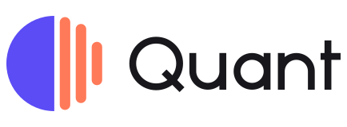

<h1></h1>

Quantify your life, and decide exactly which AI may read it.

Quant records what you do — what is on your screens, what you hear and say, which apps you use, and what your body is doing (heart rate, sleep, steps, posture, location, and any sensor you strap on later) — into an encrypted vault on your own machine. AI agents reach that vault through an MCP server, but only with a grant you approved, scoped like GitHub's fine-grained permissions, rate limited, redacted, and written to a tamper-evident audit log.

> **Status: early.** The vault, access control, daemon, CLI, MCP server, and macOS capture work and are tested end to end. The Android collector (built with [leptoskit](https://github.com/leptoskit/leptoskit)) comes next. Single user by design.

## Why

Questions like "how did I sleep after late coffee?", "when do I focus best?", or "what did we agree on in Tuesday's call?" are answerable from data you already produce. The data is also the most sensitive you have. Quant treats both facts as requirements:

- **Everything is captured, quietly.** Capture runs in a background daemon at low priority, skips frames that did not change, pauses when you are idle or the screen is locked, and never records password managers or private browsing windows.
- **Nothing is readable by default.** A new agent sees one tool that tells it how to ask you for access.
- **Access is specific.** `health:summary` lets an agent see your average heart rate per hour, never a raw sample, a screenshot, or a window title. `screen:read` gives on-screen text with secrets redacted, but no images. `audio:raw` is a deliberate choice.
- **Extraction is bounded.** Each grant has a lookback window, an expiry, and limits on requests per minute, records per hour, and bytes per day.
- **Granting needs you.** Approving an agent, purging data, or reading the audit log needs your passphrase. An agent with a shell on your machine cannot approve itself.

## How it fits together

```text
 macOS capture ──┐                        ┌── quant CLI (signed)
 Android app ────┤ signed ingest          ├── quant mcp ── Claude Code, other agents
 watch / vest ───┘        │               │      (signed, scoped, rate limited)
                          ▼               │
                ┌───────────────────────────────┐
                │ quantd                         │
                │  grants · limits · redaction   │
                │  audit chain                   │
                │  ┌──────────────────────────┐  │
                │  │ vault (SQLCipher + FTS5) │  │
                │  │ sealed media (XChaCha20) │  │
                │  └──────────────────────────┘  │
                └───────────────────────────────┘
                 private Unix socket (0600)
```

| Crate           | What it does                                                                                   |
| --------------- | ---------------------------------------------------------------------------------------------- |
| `quant_core`    | Records, sensor series, stream ids and families, the `Sink` capture sources write to.          |
| `quant_access`  | Scopes, grants, rate limits, Ed25519 request signing, redaction, the hash-chained audit log.  |
| `quant_crypto`  | The vault key, its passphrase (Argon2id) and keychain copies, media sealing.                  |
| `quant_store`   | The encrypted vault: SQLCipher records and series, full-text search, sealed media, retention. |
| `quant_api`     | The daemon's wire types.                                                                       |
| `quant_derive`  | Derived memory: posture spans from body-worn accelerometers, daily summaries.                 |
| `quant_capture_macos` | macOS capture: screen text (Vision OCR), focused apps and windows, input counts, microphone speech, the Rewind rolling audio buffer. |
| `quant_daemon`  | `quantd`: serves the API on a private socket and enforces every grant.                        |
| `quant_client`  | A signing client for the CLI, the MCP server, and devices.                                    |
| `quant_collector` | A device-side encrypted spool that queues captures offline and drains them to the vault.   |
| `quant_mcp`     | The MCP server agents talk to; its tool list follows the agent's grant.                        |
| `quant_cli`     | The `quant` command.                                                                           |

See [docs/architecture.md](docs/architecture.md) for the data model, the security model, and the roadmap.

## Quick start (macOS)

```sh
cargo install --path crates/quant_cli

quant init                 # choose a passphrase; the key also goes in your keychain
quant service install      # run the daemon at login

# Connect Claude Code. The first run asks the vault to pair and prints a code.
claude mcp add quant -- quant mcp --profile claude --scope '*:summary'
quant approve K7QD-M2XA --scope health:summary --scope apps:summary --lookback-hours 720
```

The daemon captures this Mac as soon as it starts. macOS asks once for **Screen Recording** (screenshots and window titles); grant it to `quant` in System Settings → Privacy & Security. Microphone capture is off until you turn it on:

```sh
quant status                       # what each source is doing, and why one is stopped
quant capture set --audio on       # also asks for Microphone access
quant capture set --exclude-app com.apple.Notes --ocr accurate
quant capture pause --minutes 30   # or `quant capture resume`
```

Password managers and private or incognito browser windows are never captured. Changing what is captured, or pausing it, needs your passphrase, so an agent cannot quietly turn capture off. Use `quant daemon --no-capture` to serve the vault without recording.

The menu-bar app in [desktop app](docs/desktop.md) shows the same status, pauses and resumes, saves the last minutes of audio, and approves agents, without a terminal.

## Rewind: the last day of audio

The daemon keeps a rolling buffer of everything your microphone hears and everything your Mac plays — a private, encrypted substitute for apps like Backtrack, so "save the last 10 minutes" is always possible after the fact. The buffer holds 24 hours by default (about 260 MB per track per day at 24 kbps AAC) and is deleted by the same sweep as everything else.

The difference from Backtrack is the cost. Backtrack kept a transcription model running and burned most of a core; Rewind does no continuous ML at all. While buffering it only downmixes, resamples to 16 kHz, runs the same cheap energy voice-activity detector the speech path uses, and writes 60-second AAC chunks with Apple's encoder on a utility-priority thread. Measured by feeding synthetic speech through the exact encode-and-chunk path (`cargo run -p quant_capture_macos --release --example rewind_bench`), that is **about 4 CPU-seconds per hour of audio — roughly 0.1% of one core** on an M4 Mac mini, against Backtrack's 70%. Nothing is transcribed until you save a moment; the clip is then transcribed once, on device (whisper.cpp if built with the `whisper` feature, otherwise Apple's speech recognizer).

It keeps recording while the screen is locked or you are idle — that is the point — and stops only when you pause capture. When the `audio` speech source is also on, both share one microphone stream.

```sh
quant rewind save 10m                 # the last ten minutes
quant rewind save 90s --title "call with Ada"
quant rewind save --from -1h --to -30m
quant rewind list                     # saved clips (audio:read)
quant rewind play rec_019a…           # through the speakers (audio:raw)
quant rewind export rec_019a… out.m4a
quant rewind status                   # hours buffered, disk used
```

Saving needs `audio:write` for your profile (`quant pair --scope audio:write`), because the audio never leaves the vault in the answer: the daemon joins the overlapping buffer chunks into one `.m4a`, stores it as an `audio.clip` whose media never expires, and returns only the clip's id and span. An agent with `audio:write` gets the same power through the MCP tool `quant_save_audio` ("save the last 10 minutes"). A clip's transcript lands in the record in the background, so it also turns up in `quant search`.

Pair a phone over the local network (TLS, certificate pinned by the link):

```sh
quant service install --tcp 0.0.0.0:7717
quant link                        # shows a QR code for the Quant app
```

Query from the terminal with your own, separately approved profile:

```sh
quant pair --scope '*:read'
quant approve <code>
quant overview --from yesterday
quant time apps.focus --by app --from today
quant series health.heart_rate --from -12h --bucket 1800
quant search "quarterly budget" --from -7d
quant audit                # who read what, and whether the log was tampered with
```

## Custom hardware

Anything that can print numbers can feed Quant. Register the stream, give the device its own write-only grant, and pipe samples in:

```sh
quant stream add sensor.vest.accel --channel x:m/s2 --channel y:m/s2 --channel z:m/s2 \
  --description "Chest vest accelerometer"
quant derive posture --stream sensor.vest.accel --placement torso   # read posture from it

quant --profile vest pair --kind device --scope sensor.vest:write
quant approve <code>
cat /dev/cu.usbmodem1101 | quant --profile vest ingest --stream sensor.vest.accel   # CSV: t,x,y,z
```

`quant ingest` reads CSV (`timestamp,value,…`, with an optional header naming the channels) or JSON lines, batches samples, and retries when the grant's rate limit is reached. Timestamps may be RFC 3339 or Unix seconds or milliseconds; an empty timestamp means now. With `--records`, each JSON line becomes an event record instead.

## Who you are

Quant also holds **claims** about you — preferences, values, routines, facts, relationships, goals, and commitments — each with evidence pointing at the records it came from, ranked by authority (your corrections, then what you wrote, then what Quant observed, then what an agent proposed).

```sh
quant tell "Prefers espresso after lunch" --topic coffee.timing   # states a claim
quant profile                      # your own words first, then the rest by confidence
quant claims list --status held    # what agents proposed, waiting for you
quant claims approve clm_019a…     # accept a proposal (it stays marked "inferred")
quant claims correct clm_019a… "Espresso, but never after 16:00"
```

Agents reach claims through the `memory.profile` scope: `memory.profile:summary` gives them your own words only, `:read` everything active with evidence, `:write` lets them propose (held until you approve, at most 20 per hour). Each claim carries sensitivity classes, and a grant can exclude classes outright:

```sh
quant approve K7QD-M2XA --scope memory.profile:read --scope health:summary --deny location
```

The MCP server offers `quant_profile`, `quant_propose`, and `quant_context` (a budgeted packet of claims, recent memory, and matching records sized to one task) only to grants that can use them.

## Learning on the device

Quant can also learn, using models that run on your own machine only:

```sh
quant learn set --embed-endpoint http://127.0.0.1:11434 --embed-model nomic-embed-text --embed-dims 768 \
                --extract-endpoint http://127.0.0.1:8080 --extract-model llama3.2
quant search "when do I focus best" --mode hybrid   # or `keyword` / `similar`
quant learn show                                   # or `quant learn off`
```

The embedding endpoint (an OpenAI-compatible server such as Ollama or a llama.cpp server) powers similarity search over your screens, transcripts, and memory — hybrid by default once embeddings exist, fusing keyword and meaning rankings. The extraction endpoint reads the day's summary each evening and proposes claims about you, each grounded word-for-word in the records it read; anything touching credentials, access, grants, or money movement waits for your approval as a held claim, and every claim stays traceable to the evidence behind it. Weekly reviews (`memory.weekly`) sum up sleep, heart rate, steps, focus, and the plain correlations between them, with the numbers behind each finding.

Endpoints must be literal loopback addresses (`127.0.0.1` or `[::1]`), so vault text can never leave the machine through a changed DNS name or a proxy — and everything is off until you configure it.

## Scopes

A scope is `<target>:<permission>`. Targets are `*`, a family (`health`), or a stream and its children (`sensor.vest`). Read permissions nest: `raw` includes `read`, which includes `summary`.

| Permission | Allows                                                                                       |
| ---------- | -------------------------------------------------------------------------------------------- |
| `summary`  | Aggregates: counts, durations by app or posture or sleep stage, min/mean/max per time bucket. |
| `read`     | Individual records and raw samples, with text sanitised and secrets redacted.                |
| `raw`      | Also screenshots and audio.                                                                  |
| `write`    | Sending data in (for capturing devices). Never implies reading.                              |

`audit:read` lets a client read its own audit entries.

| Family     | Streams                                                                                    |
| ---------- | ------------------------------------------------------------------------------------------ |
| `screen`   | `screen.frame`: on-screen text, app, window title, screenshot                               |
| `audio`    | `audio.transcript`: speech and its transcript; `audio.buffer`: the Rewind rolling buffer; `audio.clip`: a saved moment. Audio media is kept 24 hours by default, saved clips until you delete them |
| `apps`     | `apps.focus`: which app and window had focus, and for how long                              |
| `input`    | `input.activity`: key, click, and scroll counts per minute (never content)                  |
| `health`   | `health.heart_rate`, `health.hrv`, `health.spo2`, `health.steps`, `health.sleep`, `health.workout` |
| `motion`   | `motion.accelerometer`, `motion.gyroscope`, `motion.orientation`, `motion.posture`, `motion.gait` |
| `location` | `location.fix`, `location.visit`                                                            |
| `device`   | `device.battery`, `device.state`                                                            |
| `comms`    | `comms.notification`                                                                        |
| `sensor`   | Anything from custom hardware: `sensor.<vendor>.<channel>`                                   |
| `memory`   | `memory.note`, `memory.episode`, `memory.daily`, `memory.weekly`, `memory.profile`: what you or an agent wrote or derived, and claims about who you are |

## One application, multiple targets

Quant has one root [`leptoskit.toml`](leptoskit.toml), one Cargo workspace and
one lockfile. Each destination selects packages from that workspace; the
public website and relay deploy independently without becoming separate apps.

| Target | Code | Responsibility |
| --- | --- | --- |
| `desktop` | `platforms/macos`, `crates/quant_service`, `crates/quant_app` | Native menu-bar service, with a window created on demand. |
| `landing` | `crates/landing_*`, `crates/quant_landing_server` | Public site, its own routes and assets; no vault access. |
| `relay` | `crates/quant_relay_server`, `crates/relay_db` | Blind encrypted-connection relay with its own metadata database. |
| `web`, `android`, `ios`, `harmonyos` | Shared product frontend, future platform hosts | Declared destinations; unavailable until their transport and collector lifecycle are integrated. |

From the repository root:

```sh
leptoskit targets
leptoskit --app-target desktop build --release
leptoskit --app-target landing dev
leptoskit --app-target relay build --release
```

Use the CLI from the SDK revision pinned in `Cargo.toml`. Public assets live in
`assets/landing`; product assets live in `assets/app`. Builds go to
`dist/<target>` and generated native state stays under `.leptoskit/<platform>`.
The original core crates remain unchanged in role: capture, encrypted storage,
permissions, derivation, CLI and MCP. `cargo test` selects those core packages;
target-specific checks run separately in CI within the same workspace.

See [project layout](docs/project-layout.md), [desktop](docs/desktop.md),
[landing](docs/landing.md), and [relay](docs/relay.md). Update all SDK pins and
the single lockfile with `python3 scripts/update-leptoskit.py --no-check`.

## Inspiration

- [kizuki](https://github.com/Illuminfti/kizuki) for its capture-to-memory ledger, agent grants, and redaction.
- [screenpipe](https://screenpi.pe) for continuous screen and audio capture exposed to agents.
- Backtrack for keeping the last day of audio around in case it matters.

## License

[Unlicense](license).
